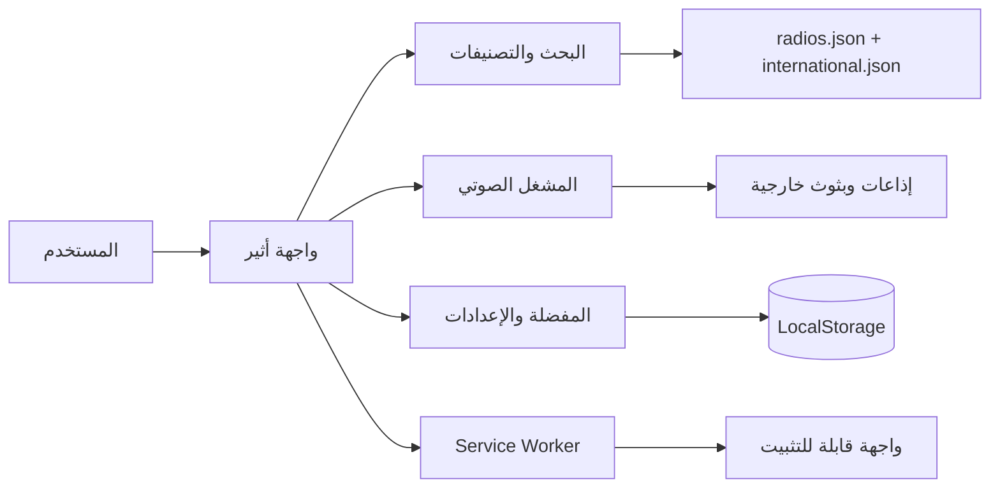

<!-- وبسم الله نبدأ -->
<div dir="rtl">

<div align="center">

# أثير
### إذاعات القرآن والقرّاء والدروس — صوتٌ يطمئنّ به القلب

<p>
  <a href="https://athir-quran-radio.montasar.chatgpt.site/"><strong>استمع الآن ↗</strong></a>
  ·
  <a href="https://github.com/Montasarkamal/Athir/releases">الإصدارات</a>
  ·
  <a href="https://github.com/Montasarkamal/Athir/issues">الاقتراحات والمشكلات</a>
</p>

<p>
  
  
  
  
</p>

> مساحة استماع عربية هادئة تجمع إذاعات القرآن الكريم، أصوات القرّاء المفضّلين، والدروس والذكر في تجربة واحدة خفيفة وسريعة.

</div>

---

## ✦ لماذا أثير؟

أثير ليس مجرد مشغّل صوت؛ إنه **رفيق استماع** صُمّم ليكون حاضرًا في لحظات العمل، والراحة، والتدبّر، مع واجهة عربية أولًا وتجربة واضحة على الهاتف والحاسوب.

| التجربة | ما الذي يقدمه النظام؟ |
|---|---|
| 🎧 استماع مستمر | تشغيل الإذاعات والبثوث الصوتية من مكان واحد |
| 🗂️ مكتبة منظمة | تصنيفات، بحث، دول، قرّاء، وسور مختارة |
| ♥ مساحة شخصية | مفضلة وإعدادات وإحصائيات محفوظة على جهاز المستخدم |
| 🌍 للجميع | العربية والإنجليزية والبرتغالية والإسبانية |
| 📱 يعمل كتطبيق | PWA قابلة للتثبيت مع Service Worker |
| 🔗 مشاركة مباشرة | صفحة مستقلة لكل محطة عبر مسار `/listen/<id>` |

## ✨ المميزات الرئيسية

- **مشغّل صوت ثابت** مع تشغيل/إيقاف، السابق/التالي، كتم الصوت، والتحكم بمستوى الصوت.
- **مؤقت نوم** بخيارات 15 دقيقة، 30 دقيقة، ساعة، أو بدون مؤقت.
- **بحث وتصفية** للعثور على الإذاعات حسب الاسم والدولة.
- **مفضلة محلية** لحفظ الأصوات الأقرب للمستخدم دون حساب أو خادم بيانات.
- **إحصائيات الاستماع** لليوم والإجمالي، محفوظة محليًا في المتصفح.
- **تصدير واستيراد الإعدادات** لنقل المفضلة والتفضيلات بين الأجهزة.
- **مشاركة المحطة الحالية** برابط مباشر قابل للفتح.
- **تعدد اللغات** مع دعم اتجاه RTL للواجهة العربية.
- **الوضع الليلي والنهاري** وتجربة متجاوبة للشاشات الصغيرة والكبيرة.
- **تثبيت كتطبيق** من خلال `manifest.webmanifest` و`sw.js`.
- **دعم HLS** عبر مكتبة `hls.min.js` للبثوث التي تحتاجها.

## 🧭 خريطة النظام



## 🛠️ البنية التقنية

أثير مشروع **Static Web App** لا يحتاج إلى npm أو خطوة build:

- **HTML** لبنية الصفحات وصفحات المشاركة.
- **CSS** للتصميم المتجاوب والوضعين الليلي والنهاري.
- **Vanilla JavaScript** للمنطق والمشغل والمفضلة والإعدادات.
- **JSON** لمصادر الإذاعات والمعلومات الدولية وبيانات الإصدار.
- **PWA APIs** للتثبيت والتخزين المؤقت.
- **HLS.js** لدعم بعض صيغ البث المباشر.

### هيكل المجلدات

```text
dist/
├── index.html                  # الصفحة الرئيسية
├── app.js                     # منطق التطبيق والمشغل والمفضلة
├── style.css                  # التصميم العام والمتجاوب
├── ui.js                      # اللغات والنصوص
├── radios.json                # قائمة الإذاعات الأساسية
├── international.json         # بيانات المحطات الدولية
├── portraits.json             # مصادر صور القرّاء
├── manifest.webmanifest       # تعريف التطبيق القابل للتثبيت
├── sw.js                      # التخزين المؤقت وتحديث الواجهة
├── assets/                    # الشعارات والأعلام والصور والمكتبات
├── listen/<id>/index.html     # صفحات الاستماع المباشر
└── share/                     # صور معاينة المشاركة
```

## 🚀 التشغيل محليًا

> لا تفتح `index.html` مباشرة من مدير الملفات؛ استخدم خادم HTTP حتى يعمل تحميل البيانات وService Worker بصورة صحيحة.

```bash
python3 -m http.server 8000 --directory dist
```

ثم افتح:

```text
http://localhost:8000
```

## 🌐 النشر

ارفع **محتويات مجلد `dist`** إلى جذر نطاق يدعم HTTPS.

### متطلبات الاستضافة

- دعم HTTPS.
- دعم صفحات `index.html` داخل المجلدات، مثل `listen/79/index.html`.
- تقديم ملفات PNG وSVG وICO وJSON وWeb Manifest بصورة صحيحة.
- تفعيل التخزين المؤقت مع احترام تحديث Service Worker.

### عند تغيير النطاق

استبدل النطاق القديم في وسوم canonical وOpen Graph وTwitter داخل صفحات HTML:

```text
https://athir-quran-radio.montasar.chatgpt.site
```

يولّد التطبيق روابط المشاركة اعتمادًا على النطاق الحالي تلقائيًا. وبعد كل تحديث مهم، غيّر قيمة `CACHE` داخل `sw.js` حتى تصل النسخة الجديدة إلى الأجهزة المثبتة.

## 📦 نسخة المصدر

توجد حزمة المصدر الكاملة داخل المستودع:

- [athir-2.2.0-source.zip](./athir-2.2.0-source.zip)
- [دليل المصادر الخارجية](./THIRD_PARTY.md)

## 🔐 الخصوصية والبيانات

لا يحتاج أثير إلى حساب حتى يعمل. تُحفظ المفضلة والإعدادات ومدة الاستماع **محليًا على جهاز المستخدم**، ولا تُرسل إلى قاعدة بيانات المشروع.

> البث والتلاوات تعتمد على مصادر خارجية وقد يختلف توفرها أو روابطها مع الوقت. التطبيق لا ينزّل تسجيلات القرآن للاستماع دون اتصال.

## ⚖️ الحقوق والمصادر

الشعارات والصور والمحتوى الصوتي تعود إلى أصحابها. راجع `THIRD_PARTY.md` و`dist/portraits.json` لمعرفة المصادر والتراخيص، واحترم شروط كل مزود عند إعادة النشر.

## 🗺️ أفكار التطوير

- مزامنة اختيارية للمفضلة بين الأجهزة.
- تحسين صفحة البحث والاقتراحات.
- اختبارات آلية لمسارات المشاركة.
- إضافة إشعارات تحكم للمشغل في الأجهزة الداعمة.

---

<div align="center">

**أثير — استمع. تدبّر. واطمئن.**

صُنع بعناية بواسطة **Montasar kamal** · 2026

</div>

</div>
